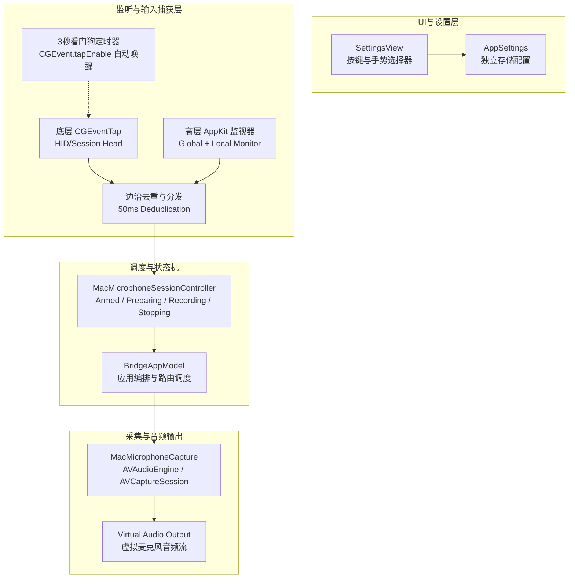

# Mac 麦克风独立语音键与双通道防休眠监听实现原理

本文档记录了 SayAll（无线麦 SayAll）中 **Mac 麦克风独立语音键、点按/长按手势解耦、双通道事件捕获与防超时自愈保活机制** 的实现方案与技术原理。

---

## 一、背景与设计目标

### 1. 既有架构的局限
- **遥控器与 Mac 麦克风耦合**：原项目中 Mac 本地麦克风的触发键与手势完全绑定在物理遥控器的全局配置上（默认随 Fn 键或遥控器设置），无法为 Mac 麦克风单独指定按键与交互手势。
- **第三方输入法协同冲突**：常见第三方 AI 语音工具（如豆包语音输入法、讯飞等）常配置为特定物理按键（如右侧 Option 键 `Right Option`）且采用**点按切换（Toggle：按一下开启，再按一下停止）**手势。
- **长时间空闲后功能失效**：原机制仅使用单个底层 `CGEventTap` 监听按键，在 macOS 系统空闲 10~15 分钟后，容易被 macOS WindowServer 机制静默挂起或由于麦克风冷启动慢触发超时，导致按键失去响应，用户被迫反复打开设置重新启用。

### 2. 核心设计目标
1. **完全解耦配置**：Mac 麦克风拥有独立的语音触发键（Fn、Left/Right Command、Left/Right Option）和手势（长按 Hold、点按开/关 Toggle），与遥控器各司其职，互不干扰。
2. **双通道事件监听，防 WindowServer 静默挂起**：采用底层 `CGEventTap` + 高层 AppKit `NSEvent` 监视器双重冗余架构，永不失活。
3. **冷启动宽容与自动保活自愈（Auto-Rearm）**：避免单次音频冷启动缓慢或录音异常导致麦克风功能整体被关闭，确保按键监听 100% 常驻后台。
4. **开机/启动自动就绪**：应用启动且音频输入设备加载完成后自动进入就绪等待（Armed）状态，无需用户手动打开设置触发。

---

## 二、系统架构与模块设计

系统由以下 6 个核心模块协同工作：



### 1. 配置层 (`AppSettings.swift`)
新增两个独立的响应式设置项，支持持久化存储到 `UserDefaults` 并向 SwiftUI 发布变更：
- `macMicrophoneVoiceKeyMode: VoiceKeyMode?`：独立按键（`fn`, `left_command`, `right_command`, `left_option`, `right_option`）。
- `macMicrophoneVoiceGestureMode: VoiceGestureMode?`：独立手势（`hold` 长按, `toggle` 点按开/关）。

### 2. 交互与展示层 (`SettingsView.swift`)
在「备用 Mac 麦克风」区域提供独立的按键 Picker 和手势 Picker：
- 按键选择器：支持选择系统 Fn、左/右 Command、左/右 Option。
- 模式选择器：支持选择「按住说话（Hold）」与「单击开始/停止（Toggle）」。
- 动态状态反馈：显示就绪等待（Armed）或录音中（Recording）的状态灯和文字。

### 3. 双通道事件监听器 (`MacMicrophoneVoiceKeyMonitor.swift`)
监听器采用双重安全冗余设计：
- **通道 A（底层硬件级 `CGEventTap`）**：
  - 优先在 `.cghidEventTap` 级别创建监听，捕获物理输入事件流。
  - 若 HID 级别不可用，自动降级至 `.cgSessionEventTap`。
  - 采用 listen-only 模式，绝不吞没或拦截系统与其他 App（如豆包）对该按键的响应。
- **通道 B（高层 Cocoa/AppKit 全局与本地监视器）**：
  - `NSEvent.addGlobalMonitorForEvents(matching: .flagsChanged)`：捕获其他前台 App 激活时的物理按键边沿。
  - `NSEvent.addLocalMonitorForEvents(matching: .flagsChanged)`：捕获当前 App 为前台激活窗口时的按键边沿。
  - AppKit 监视器运行在更高层级，不受 WindowServer 针对底层 EventTap 的空闲超时机制影响，只要进程在运行就绝对不会失效。
- **通道 C（底层 `IOHIDManager` 原始 HID 键盘输入监听）**：
  - 使用 `IOHIDManagerCreate(..., kIOHIDOptionsTypeNone)` 只读旁路监听物理键盘与 Apple TopCase `Fn` 输入值，不独占设备。
  - 工作在 `CGEventTap` 之下的 IOKit 层，即使其他 App 的主动 `CGEventTap` 吞掉了按下事件（如 `Right Option` key-down），`IOHIDManager` 仍能稳定捕获原始按下与抬起边沿。
- **50ms 边沿去重器**：
  - 多通道同时捕获到同一按键事件时，以 `(pressed, observedAt)` 与 50ms 时间窗口进行去重，确保点按 Toggle 时只触发一次状态翻转。
- **看门狗巡检（Watchdog）**：
  - 启动每 3 秒触发一次的保安定时器，检查 `CGEvent.tapIsEnabled(tap: port)`，若发现被 WindowServer 挂起，立即调用 `CGEvent.tapEnable` 重新唤醒。

### 4. 状态机与保活自愈 (`MacMicrophoneSessionController.swift`)
管理 Mac 麦克风的完整生命周期：
```text
  [Idle] 
     │  (启动/设置就绪)
     ▼
  [Armed] ◄─────────────────────────────────┐
     │                                      │
     │ (按键按下 / Toggle 下降沿)            │ (录音结束 / 单次非致命失败)
     ▼                                      │
 [Preparing] ───► [Recording] ───► [Stopping]
     │                 │
     └─────────────────┴──► (权限缺失 / 硬件拔出: 永久错误) ──► [Failed / Disabled]
```
- **Toggle 点按处理**：只在按下（`pressed == true`）的瞬间翻转 `captureRequested`，松手（`pressed == false`）时不中断会话。
- **Hold 长按处理**：按下进入会话，松手退出会话。
- **非致命错误自愈（Auto-Rearm）**：
  - 明确划分 **永久性错误**（`permission`, `accessibility`, `inputMonitoring`, `inputUnavailable`, `outputUnavailable`）与 **运行时单次错误**（`noAudio`, `capture`, `busy`, `interrupted`, `timedOut`）。
  - 对于运行时单次错误，会话结束后**强制保持 `isEnabled = true`，自动回到 `.armed` 状态**，绝对不注销按键监听器，用户下一次按键仍能正常触发。

### 5. 麦克风音频采集优化 (`MacMicrophoneCapture.swift`)
- **冷启动缓冲放宽**：将首次 PCM 音频数据包到达的看门狗超时由原来的 2 秒放宽至 **5 秒**，为长时间深度休眠唤醒的 Apple Silicon CoreAudio DSP 芯片留足就绪时间，避免误报 `no_audio`。
- **异步安全启动**：使用主线程投递安全事件，底层使用 Dedicated Queue 隔离采集和重采样转换。

### 6. 应用编排调度 (`BridgeAppModel.swift`)
- **启动自动就绪**：在 `publishAudioDevices` 完成输入与输出设备枚举后，自动检查 `settings.macMicrophoneVoiceKeyMode`，若已配置且设备就绪，立即异步调用 `toggleMacMicrophone(from: .connectionPage)` 自动 Armed，无需手动打开设置页面。

---

## 三、关键故障根因分析与针对性解决

| 故障现象 | 根本原因 (Root Cause) | 解决方案 (Solution) |
| :--- | :--- | :--- |
| **一开始正常，空闲 10~15 分钟后再按无效** | macOS WindowServer 机制会对无连续事件的 `CGEventTap` 执行静默超时挂起（`kCGEventTapDisabledByTimeout`），原逻辑无有效唤醒机制。 | 引入高层 **AppKit 全局+本地监视器**（永不被挂起）组成双通道；底层补充 **3 秒巡检看门狗**自动 re-enable。 |
| **空闲时间长后按一次，备用麦克风自动关闭** | 麦克风硬件休眠唤醒稍慢，超过旧的 2 秒硬超时判定为 `no_audio`；状态机把 `no_audio` 当作致命错误执行了 `isEnabled = false`，导致监听被注销。 | ① 首包超时放宽至 **5 秒**；<br/>② 状态机将 `no_audio` 归入**非永久错误**，失败后自动重置回 `.armed` 状态，按键监听永远常驻。 |
| **重启 App 后必须打开一次设置界面才能使用** | `macMicrophoneDevices` 在启动时为异步加载，启动瞬态设备列表为空，启动检查直接退出，只有打开设置界面触发 `refreshAudioDevices` 才会重新检查。 | 在 `publishAudioDevices` 完成回调中增加自动就绪判断，异步设备加载完毕后自动进入 Armed 状态。 |
| **点按一次有时会瞬间开又关** | 双通道（CGEventTap 和 NSEvent）各自派发了一次按下边沿，导致 Toggle 手势被翻转了两次。 | 在事件分发中心增加 **50ms 时间戳与状态去重**，同一个物理动作仅派发一次边沿事件。 |

---

## 四、验证与自愈日志特征

在 `~/Library/Logs/RemoteMic/runtime.log` 中，正常的双通道自愈与保活生命周期体现为以下日志：

1. **启动与双通道就绪**：
   ```text
   MAC MICROPHONE KEY_MONITOR phase=started result=listening voice_key=right_option tap=hid_head
   MAC MICROPHONE operation_id=1 phase=armed result=waiting_for_voice_key capture_running=false
   MAC MICROPHONE KEY_MONITOR phase=appkit_monitors_started voice_key=right_option
   ```
2. **点按触发录音**：
   ```text
   MAC MICROPHONE KEY_MONITOR phase=edge_observed source=cgevent_tap pressed=true
   MAC MICROPHONE operation_id=1 phase=voice_key edge=down gesture=toggle
   MAC MICROPHONE CAPTURE operation_id=2 phase=started result=engine_running
   ```
3. **单次录音结束或异常后自动 Armed 回归**：
   ```text
   MAC MICROPHONE operation_id=2 phase=completed result=stopped completion=normal reason=user_stop
   // 麦克风仍然保持 armed，不需要重新打开设置，下一次按键直接生效
   ```

---

## 五、受影响的文件清单

1. `Sources/RemoteMic/AppSettings.swift`：新增独立按键与手势配置字段及存储。
2. `Sources/RemoteMic/SettingsView.swift`：设置界面交互 Picker 与状态灯渲染。
3. `Sources/RemoteMic/MacMicrophoneVoiceKeyMonitor.swift`：双通道监听器（CGEventTap + AppKit 全局/本地监视器）及看门狗定时器。
4. `Sources/RemoteMic/MacMicrophoneSessionController.swift`：Toggle/Hold 手势状态机与非致命错误 Auto-Rearm 自愈逻辑。
5. `Sources/RemoteMic/MacMicrophoneCapture.swift`：麦克风冷启动探测超时从 2 秒延长至 5 秒。
6. `Sources/RemoteMic/BridgeAppModel.swift`：输入设备加载完成后的自动 Armed 编排与生命周期绑定。
